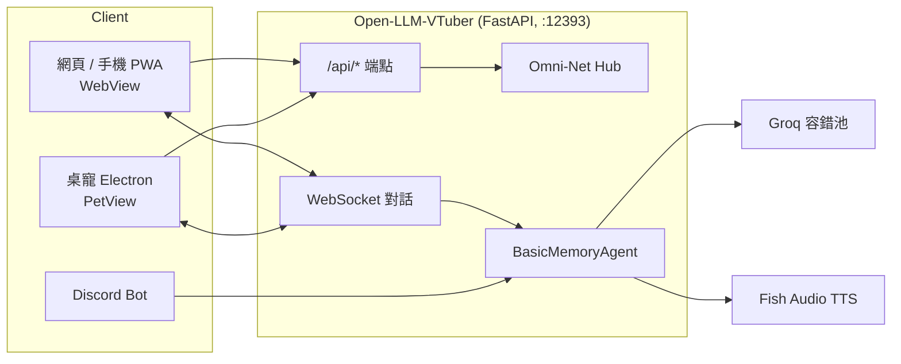

# 愛蜜莉雅 (Emilia) 靈動生物引擎 Live2D 桌面寵物

> 原汁原味《Re:從零開始的異世界生活》愛蜜莉雅桌面伴侶。融合官方 Live2D 渲染、微表情生物模擬引擎、Fish Audio 高橋李依聲線、Groq 秒級容錯大模型池、零 Token 螢幕視覺感知、Omni-Net 聯網中樞、跨裝置 Soul-Link 同步、Discord 連動與音樂旋律編舞系統。

**目前版本：v2.2.0**（2026-11-18）｜完整更新歷程見 [docs/CHANGELOG.md](docs/CHANGELOG.md)

---

## 📑 目錄

1. [功能總覽](#-功能總覽)
2. [系統架構與專案結構](#-系統架構與專案結構)
3. [快速啟動](#-快速啟動)
4. [操作說明](#-操作說明)
5. [好感度羈絆系統 3.0](#-好感度羈絆系統-30)
6. [後端 API 一覽](#-後端-api-一覽)
7. [設定與資安](#-設定與資安)
8. [版本紀錄摘要](#-版本紀錄摘要)
9. [開發維護硬性規範](#-開發維護硬性規範)

---

## 🌟 功能總覽

### 🖥️ 介面與桌寵
| 功能 | 說明 |
|---|---|
| 純淨桌寵介面 | 預設僅 Live2D 角色 ＋ 底部懸浮 `InputSubtitle` 對話卡片 ＋ 頂部 HUD，不載入 Repo 儀表板／側邊欄（見[介面純粹性原則](#-開發維護硬性規範)） |
| 桌寵 / 網頁解耦 | `PetView`（Electron，`?mode=pet`）與 `WebView`（瀏覽器，`?mode=web`）為兩個獨立模組，樣式與邏輯互不污染，並可雙向切換 |
| 無邊框透明桌寵視窗 | 440×700 緊湊視窗、100% 透明、預設停靠螢幕左下角，座標持久化於 `pet_bounds.json`，支援滑鼠穿透 |
| 靈動控制台 | 桌寵：右上角紫水晶吊墜展開毛玻璃 Console Deck（換裝／BGM／番茄鐘／視覺感知／語音喚醒／冒險日記／好感羈絆／歷史對話接續）；網頁：`WebToolMenu` 抽屜 |
| 手機網頁 / PWA | `100dvh` + 安全區適配、角色固定置中、滑出式抽屜、快捷提示詞膠囊、PWA manifest |
| 日文主字幕 ＋ 繁中副字幕 | 日文原聲大字、繁中翻譯小字（0ms 括號雙語解析，缺失時呼叫 `/api/translate`）、逐字打字機、4-Bar 語音等化器 |
| 物理阻尼嘴形 | 非對稱指數低通（Attack 20 / Decay 12）消除 Lip Sync 抽動 |
| 一鍵換裝 | 4星經典大衣 ⇄ 4星夏日泳裝，換裝後保留同一記憶池與對話上下文 |
| 接續歷史聊天 | 所有造型共用 `conf_uid: emilia_4star_001`；控制台可查看、接續、新建、刪除歷史對話 |

### 🧠 AI 與對話
| 功能 | 說明 |
|---|---|
| Groq 容錯模型池 | 主力 `qwen/qwen3.8-27b`，遇 429 於 0.1 秒內切至 `openai/gpt-oss-120b` / `gpt-oss-20b`，自動清洗字串；Vision 429 短暫重試 |
| Fish Audio TTS | 高橋李依聲線克隆，`balanced` 延遲模式 |
| 日文發言語言防線 | 系統提示末尾強制括號外 100% 日文、繁中翻譯僅置於 `(...)` 內 |
| 長期記憶 | 2 秒防抖非同步落盤、`_id_to_idx` 雜湊 $O(|C|)$ 檢索、緊湊 JSON |
| 好感度人格注入 | 依 Lv.1~Lv.8 注入對應語氣與觸控反應描述 |
| 日記 / 情書生成 | `/api/generate-diary`：依近期對話與心情生成「冒險日記」或 Lv.4+「戀人親筆情書」，無 LLM 時有保底文案 |
| 麥克風 | 目前**停用**語音接收與 VAD（`AUDIO_INPUT_DISABLED = true`），愛蜜莉雅 TTS 發聲完整保留 |

### 🌐 Omni-Net 聯網中樞（`internet_hub.py`）
- **即時聯網搜尋**：Google News 台灣版 RSS ＋ 中文維基 OpenSearch，時事／知識問題自動注入。
- **網址導讀**：YouTube oEmbed、Jina Reader、HTML 清洗。
- **台灣即時天氣**：Open-Meteo（15 分鐘快取），顯示於 HUD 並注入對話。
- **ACG／科技頭條與晨間簡報**：巴哈姆特 GNN ＋ Google 新聞，網頁端「☀️ 今日晨間簡報」一鍵播報。

### 👁️ 智慧桌面觀察（零 Token）
- `/api/capture-screen`：本機 16×9 分塊 Perceptual Diff，遮罩桌寵自身視窗（`pet_bounds.json`），未變動即攔截，Token 為 0。
- `/api/desktop-status`：GNOME Mutter `IdleMonitor` 閒置時間、運行應用、焦點視窗。
- **主動關懷**：3 分鐘觀察冷卻、免打擾（說話／打字／番茄鐘／剛聊天）、離開 5 分鐘後回座「おかえりなさい！」、專注 30 分鐘貼心提醒、`[SILENT]` 靜默陪伴；背景觀察與聊天記憶隔離（`proactive_vision` / `skip_history` / `skip_memory`）。
- **意圖觸發看螢幕**：「你猜我在做什麼？」「幫我看這個報錯」等語句自動附帶截圖。

### 🎵 音樂與編舞
- **全網搜歌與串流**：Apple iTunes（JP/TW 並行，256kbps AAC）＋ SoundCloud 備援；`/api/music-search`、`/api/music-stream` 同源代理並以 SHA1 磁碟快取（`cache/music/`），確保 `AnalyserNode` 可讀頻譜。
- **自然語言點歌**：「幫我上網找 YOASOBI 的 Idol」「播放 周杰倫 晴天」→ `[bgm:play:{query}]` / `[bgm:next]` / `[bgm:stop]`。
- **內建多聲部曲庫**：《Stay Alive》《Wishing》《Realize (124 BPM)》《異世界暖陽 Lofi》《微精靈之歌》。
- **1024-FFT 旋律追蹤**：主旋律音高 → 仰首／低頭，低頻瞬態與 BPM → 節拍，人聲頻譜 → 跟唱嘴型。
- **六段式編舞**：💃 偶像重拍彈跳／🎶 旋律追隨＋雙手波浪／✨ 8 字立體律動／🌸 副歌躍動轉身／⭐ 側步花式打拍／🌙 夢幻華爾滋，可自動輪替或一鍵「🔀 換舞步」。
- **點唱機 UI**：網頁端搜尋框、專輯封面、當前曲目與舞步徽章。

### 🔗 連線與同步
- **跨裝置 Soul-Link**：`/api/companion-state` 原子合併好感度、愛稱、日記、音樂狀態至 `cache/companion_state.json`（以 `updatedAt` 判斷新舊），桌寵／網頁／Discord 共用。
- **區網與外網**：`/api/network-info` 自動探測區網 IP 與 Cloudflare Tunnel；網頁內建純 TS ISO-18004 **QR Code 掃碼配對**；`ws:`/`wss:` 依 Origin 動態選擇。
- **Discord Bot**（`discord_bot.py`）：Gateway v10 ＋ REST，支援 DM、@提及與 `!emilia` / `!weather` / `!briefing` / `!sing`，共用記憶與好感度，可附 Fish Audio 日語語音；網頁控制台一鍵設定 Token 與啟停（`/api/discord-config`）。

### ⚡ 效能
- 前端：`EmiliaDialogueCard` Memoized、Vite `manualChunks`（`vendor-ai` / `vendor-utils`）、翻譯 120ms 防抖、移除全頁 MutationObserver、`AudioContext` 單例、`WeakMap` 參數快取、WAV 16-bit PCM 向量化讀取、生物微動於 `model.update()` 前注入。
- 桌寵主進程：`saveBounds` 300ms 防抖＋非同步寫檔；`LAppPal` 以 `performance.now()` 計時並限制 delta（1~50ms）。
- 後端：`asyncio.to_thread` 卸載截圖／音訊、`.wav` 免 ffmpeg、`AsyncOpenAI` 連線池＋LRU 翻譯快取、`LazyASREngine`（啟動由 4 秒降至約 1 秒）。

---

## 🏗️ 系統架構與專案結構



```
Live2D_pet/
├── README.md                 # 本文件
├── docs/CHANGELOG.md         # 完整版本更新紀錄
├── start_pet.sh / stop_pet.sh / restart_pet.sh
├── .gemini/rules/project_rules.md   # 版本更新硬性規範
├── models/                   # Emilia 原始模型素材
├── cache/                    # companion_state / music / discord_config（不入版控）
├── Open-LLM-VTuber/          # Python 後端
│   ├── conf.yaml, model_dict.json, characters/*.yaml
│   ├── capture_screen.py, run_server.py
│   ├── live2d-models/        # emilia_4star, emilia_4star_ss, mao_pro, shizuku
│   └── src/open_llm_vtuber/  # server.py, discord_bot.py, utils/internet_hub.py,
│                             # agent/agents/basic_memory_agent.py ...
└── Open-LLM-VTuber-Web/      # Electron + React 前端
    ├── pet-main.cjs / pet-preload.cjs / pet_bounds.json
    └── src/renderer/
        ├── src/pet/ (PetView)、src/web/ (WebView, WebToolMenu)
        ├── public/assets/emilia_biometric_enhancer.js  # 生物微動／好感度／編舞／控制台
        └── WebSDK/ (LAppModel 等 Live2D 渲染層)
```

---

## 🚀 快速啟動

```bash
./start_pet.sh     # 啟動後端 (run_server.py) 並等待 12393 就緒，再啟動 Electron 桌寵
./stop_pet.sh      # 停止所有桌寵服務
./restart_pet.sh   # 重啟
# 或手動：cd Open-LLM-VTuber-Web && npm run pet
```
日誌：`Open-LLM-VTuber/logs/autostart_server.log`、`Open-LLM-VTuber-Web/logs/autostart_pet.log`。
前端開發：`npm run dev` / `npm run build` / `npm run typecheck`。

**存取入口**
- 本機網頁：`http://localhost:12393`
- 區網：`http://<區網IP>:12393`（IP 可由 `/api/network-info` 或網頁 QR 取得）
- 外網 HTTPS：`cloudflared tunnel --url http://localhost:12393`

---

## 🎮 操作說明

| 操作 | 效果 |
|---|---|
| 左鍵點擊 / 撫摸角色 | 100% 保留給 Live2D 觸控互動（摸頭、戳臉頰、拍肩……） |
| **右鍵 / 中鍵拖曳**、**Alt＋左鍵拖曳** | 移動桌寵視窗（微小位移視為點擊） |
| 右鍵（無拖曳） | 桌寵選單：保持置頂／重新載入／結束桌寵（經 `pet-show-context-menu` IPC） |
| 紫水晶吊墜 | 展開／收合靈動控制台 |
| 對話卡片 | 點擊立即展開全句；輸入文字或點歌／問天氣／要簡報 |
| 系統匣 | Tray 圖示控制桌寵 |

桌寵模型固定於 `y = 0.10`（頂部留白供氣泡顯示）。

---

## 💖 好感度羈絆系統 3.0

分數起始為 **0**，每 **+350** 於 Lv.8 後點亮一顆星 ★。依部位觸控解鎖，具短時間疲勞扣減、每日效率軟上限與心情（PAD）加成，低落時安撫有「破涕為笑」增益。

| 等級 | 名稱 | 門檻 | 解鎖 |
|---|---|---|---|
| Lv.1 | 初識同伴 | 0 | 基礎日常對話、撫摸銀髮、戳戳臉頰、番茄鐘 |
| Lv.2 | 信任夥伴 | 80 | 拉衣角／輕拍肩、害羞微表情、天然呆碎碎念 |
| Lv.3 | 知心守護 | 220 | 雙手輕捧臉頰、破涕為笑、AI 記憶日記 |
| Lv.4 | 專屬戀人 (EMT) | 450 | 專屬愛稱、十指緊扣牽手、輕捏臉頰、吃醋哄她、約會小劇場、戀人情書 |
| Lv.5 | 精靈的契約者 | 800 | 親手餵食點心、契約水晶心跳共鳴、全主題約會劇場、紀念卡 |
| Lv.6 | 月下花海的誓約 | 1300 | 背後環抱／靠肩依偎、耳畔早晚安與哄睡語音、真心話檔案 |
| Lv.7 | 銀白之戀 · 冰結羈絆 | 2000 | 摸下巴逗笑、純愛回憶語音、吃醋秒變害羞 |
| Lv.8 | 永恆的半身 | 2800 | 主動索抱／索吻、無限星級、永恆誓約 |

- 前後端門檻一致（`emilia_biometric_enhancer.js` 與 `discord_bot.py`），並由 Soul-Link 以較新 `updatedAt` 為準同步。
- 觸控部位：頭、肩、臉頰、手、嘴、水晶、擁抱、耳語、下巴；未達等級顯示 🔒 解鎖提示。

---

## 🔌 後端 API 一覽

| 端點 | 用途 |
|---|---|
| `GET /api/capture-screen` | 螢幕感知（僅限本機／區網，外網回 403） |
| `GET /api/desktop-status` | 閒置時間、運行應用、焦點視窗 |
| `POST /api/translate` | 日→繁中翻譯（AsyncOpenAI＋LRU） |
| `GET/POST /api/companion-state` | Soul-Link 同步 |
| `GET /api/network-info` | 區網 IP／Tunnel 網址 |
| `GET /api/internet-briefing` | 晨間簡報與天氣 |
| `GET /api/music-search`、`/api/music-stream` | 全網搜歌與同源串流代理 |
| `POST /api/generate-diary` | 日記／情書生成 |
| `GET/POST /api/discord-config` | Discord Bot 設定與啟停 |
| `/web-tool`、`/live2d-models/info`、`POST /asr` | 原生 Open-LLM-VTuber 路由 |

---

## 🔐 設定與資安

- **Groq 金鑰**：環境變數 `GROQ_API_KEY` 或 `conf.yaml` 的 `groq_llm.llm_api_key`，程式碼不含硬編碼。
- **角色設定**：`Open-LLM-VTuber/characters/emilia_4star*.yaml`（大衣、泳裝、GPT-120B、LLaMA-70B 變體，`conf_uid` 一致）。
- **伺服器**：預設 `0.0.0.0:12393`，僅本機請改為 `127.0.0.1`。
- `.gitignore` 排除 `.venv/`、`node_modules/`、`dist/`、`out/`、`logs/`、`cache/` 與大型模型。

---

## 📜 版本紀錄摘要

> 詳細內容請見 [docs/CHANGELOG.md](docs/CHANGELOG.md)。

### [v2.2.0] - 2026-11-18（本次整合）
- **好感度系統 3.0**：起始分數改 0；門檻調為 80/220/450/800/1300/2000/2800；星級間距 250→350；Lv.3 更名「知心守護」；新增肩、嘴、擁抱、耳語、下巴等觸控部位與逐級解鎖／🔒 提示；疲勞扣減、每日軟上限、PAD 心情加成與破涕為笑增益；後端 `intimacy_map` 同步加入各級觸控反應語氣。
- **Soul-Link 合併修正**：伺服器 `updatedAt` 較新時以伺服器為準，避免舊本機分數覆寫。
- **桌寵操作改版**：左鍵專供 Live2D 觸控；右鍵／中鍵／Alt＋左鍵拖曳移視窗；右鍵選單改由 IPC 觸發；`__emiliaHandledPartTap` 避免與原生 TapBody 重複觸發；模型固定 `y=0.10`、`#emilia-pet-ui-layer` 全螢幕穿透層。
- **渲染穩定化**：`LAppPal` 以 `performance.now()` 並限制 delta；Idle 動作循環；嘴形參數平滑回正。
- **語言防線**：系統提示末端新增日文發言絕對規則。
- **文件整合**：README 重新編排為功能／架構／操作／API 結構，完整歷史移至 `docs/CHANGELOG.md`。

| 版本 | 重點 |
|---|---|
| v2.1.0 | 全網音樂串流點播、1024-FFT 旋律追蹤、六段式編舞、線上點唱機 |
| v2.0.0 | Omni-Net 聯網中樞、Soul-Link／PWA／QR、Discord Bot、多聲部合成器節奏熱舞 |
| v1.10.0 | 接續歷史聊天、統一造型記憶池、`emiliaHistoryBridge` |
| v1.9.1 | 智慧桌面觀察、3 分鐘主動守護、意圖看螢幕、靜默記憶隔離 |
| v1.9.0 | 資安白名單與金鑰外置、Lazy ASR、雙語 0ms 解析、`emiliaBridge`、分包 |
| v1.8.0 | 全棧效能重構（零阻塞事件循環、$O(|C|)$ 記憶、PCM 向量化） |
| v1.7.2 | 停用麥克風接收，保留 TTS |
| v1.7.1 | 全端效能優化、翻譯防抖、AsyncOpenAI 池、TTS balanced |
| v1.7.0 | 日文主字幕／繁中副字幕、打字機、等化器、阻尼嘴形 |
| v1.6.4 | 桌寵渲染修復、`preserveDrawingBuffer`、雙啟動腳本 |
| v1.6.3 | 動漫毛玻璃控制台與 `WebToolMenu` |
| v1.6.2 | 放大對話框、`/api/translate` 即時翻譯 |
| v1.6.1 | 手機網頁優化、角色置中 |
| v1.6.0 | 桌寵 / 網頁解耦 |
| v1.5.2 | 黃金比例校正 |
| v1.5.1 | 440×700 視窗、左下角定位、視窗級拖曳 |
| v1.5.0 | 全透明背景、適中比例、平滑拖曳 |
| v1.4.0 | 移除走路／移動機制，原地陪伴 |
| v1.3.0 | 純淨桌寵聊天框、動態 ws/wss、版本規範 |
| v1.2.0 | 恢復透明桌寵、桌面觀測、30 分鐘待機插話、Groq 容錯池、HUD |

---

## 📌 開發維護硬性規範

1. 每次功能調整／修正／重構／版本更新，**必須完整 Git Commit**（主目錄與相關子專案，訊息如 `feat(ui): ...`）。
2. 每次更新**必須同步更新本 README 與 `docs/CHANGELOG.md`**（日期、版本、功能、驗證狀態）。
3. **介面純粹性原則**：桌寵與網頁預設一律為「Live2D 角色 ＋ 懸浮 InputSubtitle 卡片 ＋ 頂部 HUD」，不得預設載入側邊欄、全螢幕儀表板或鏡頭／螢幕分頁。
